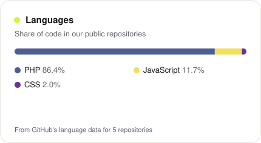
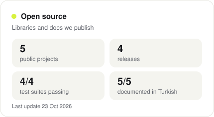

  

  <picture>
    <source media="(prefers-color-scheme: dark)" srcset="cards/services-dark.svg">
    
  </picture>

**İrodev** is a small web and software studio for businesses in Turkey and the UK. We build corporate websites,
online stores, custom PHP software and Telegram bots, and make businesses visible on Google, Google Maps and AI
search. Every project starts with a written, fixed-price quote, and the client owns all the code.

### What we work with

  <picture>
    <source media="(prefers-color-scheme: dark)" srcset="cards/stack-dark.svg">
    
  </picture>

### Open source

  <picture>
    <source media="(prefers-color-scheme: dark)" srcset="cards/languages-dark.svg">
    
  </picture>
  <picture>
    <source media="(prefers-color-scheme: dark)" srcset="cards/projects-dark.svg">
    
  </picture>

Tools we built for our own work and released for everyone, with documentation in English and Turkish:

| Project | |
| --- | --- |
| [**indexnow-php**](https://github.com/irodevltd/indexnow-php) | Automatic IndexNow for PHP sites: tells Bing, Yandex and the other engines which pages changed, straight from your sitemap. |
| [**turkish-seo-text**](https://github.com/irodevltd/turkish-seo-text) | Turkish text tools for SEO: a stemmer that follows vowel harmony, Ateşman readability, keyword and phrase analysis. |
| [**llms-txt-php**](https://github.com/irodevltd/llms-txt-php) | Build, check and serve llms.txt, llms-full.txt and AGENTS.md from your own data. |
| [**kvkk-gdpr-consent**](https://github.com/irodevltd/kvkk-gdpr-consent) | A small cookie banner for Google Analytics under KVKK and GDPR: nothing loads before "Accept". |
| [**seo-criteria**](https://github.com/irodevltd/seo-criteria) | 99 SEO and 46 AI-visibility criteria with step-by-step fixes, and 17 myths with their sources. |

### Free tools

- [SEO audit](https://irodev.net/ucretsiz-seo-analizi): 80+ checks on any page, each with why it matters and how to fix it, plus a PDF.
- [AI visibility test](https://irodev.net/geo-ai-gorunurluk): can ChatGPT, Gemini, Perplexity and Google's AI features reach and quote your site?

### Contact

[irodev.net](https://irodev.net) · [info@irodev.net](mailto:info@irodev.net) · [Pricing](https://irodev.net/fiyatlar) · [Ask for a quote](https://irodev.net/iletisim)

---

**Türkçe** · İrodev; Türkiye ve Birleşik Krallık'taki işletmeler için kurumsal web siteleri, e-ticaret mağazaları,
özel PHP yazılımları ve Telegram botları geliştiren, işletmeleri Google, Haritalar ve yapay zekâ aramalarında görünür
kılan küçük bir stüdyodur. Her proje yazılı ve sabit fiyatlı bir teklifle başlar; kodun tamamı müşterinindir. Açık
kaynak araçlarımızın hepsinin Türkçe belgesi var.
[Ücretsiz SEO analizi](https://irodev.net/tr/ucretsiz-seo-analizi) ·
[AI görünürlük testi](https://irodev.net/tr/geo-ai-gorunurluk) ·
[Fiyatlar](https://irodev.net/tr/fiyatlar) · [İletişim](https://irodev.net/tr/iletisim)

The cards are rebuilt every day from GitHub's public data by [tools/cards.php](tools/cards.php). Technology
logos from Simple Icons (CC0); each is a trademark of its owner.
